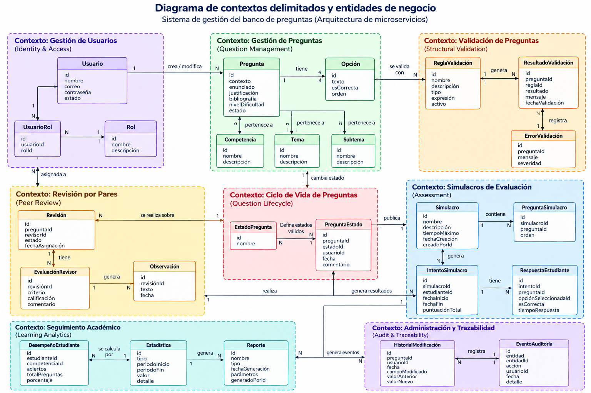

# Ingeniería de Software II

## Teoría y Laboratorio

## Entregables Proyecto de Curso - Segundo Corte 2026.2

**Fecha creación:** 1 Oct 2026  
**Última actualización:** 2 Oct 2026 12:00 PM

## Entregables

Hacer una refactorización de la iteración 1 implementando una solución distribuida con arquitecturas microservicios y orientada a eventos para garantizar la escalabilidad. La Figura 1 muestra un diseño de contextos delimitados que sirve de base para orientar esta iteración. Considerar la Figura 1 como una aproximación; cada grupo puede proponer su propio bounded context.

Utilizar, además, al menos 6 patrones de diseño GoF (2 creacionales, 2 estructurales y 2 de comportamiento). Para esta iteración, se agrega una historia de usuario que aparece en azul.

A continuación, los requisitos funcionales que se deben entregar para el segundo corte.

<figure align="center">  <figcaption><b>Figura 1.</b>Diagrama de contextos delimitados y entidades de negocio</figcaption> </figure>
> **Figura 1.** Diagrama de contextos delimitados y entidades de negocio. Sistema de gestión del banco de preguntas (Arquitectura de microservicios).

## Requisitos funcionales

Se deben implementar los siguientes requisitos funcionales de alto valor para el cliente:

1. Yo como autor de preguntas necesito crear preguntas de selección múltiple con única respuesta acorde a los principios del Diseño Centrado en Evidencia para alimentar el banco de preguntas Saber Pro.  
    **Contexto:** Cada pregunta debe tener: Contexto, Pregunta directa, Cuatro distractores, Respuesta correcta, Justificación de la respuesta, Bibliografía, Competencia, Tema, Subtema, Nivel de dificultad. Al momento de grabar el sistema debe aplicar la validación estructural (ver HU03).
    
2. Yo como autor de preguntas necesito cambiar el estado de mis preguntas de “borrador” a “Pendiente de revisión” para que el administrador les asigne al menos un revisor.  
    **Contexto:** los estados se deben visualizar con colores.
    
3. Yo como autor de preguntas necesito listar las preguntas que he creado para poder más adelante verlas y editarlas.  
    **Contexto:** aplicar paginación y filtros para hacer funcional y usable la búsqueda y listado de preguntas.
    
4. Yo como administrador necesito asignar revisores (entre 1 y 3) de las preguntas en estado “Pendiente de revisión” para que las preguntas sean revisadas por otros docentes.  
    **Contexto:** Una vez asignados los revisores, el sistema enviará un email para ser notificados.
    
5. Yo como revisor de preguntas necesito listar las preguntas que me han sido asignadas por el administrador para poder leerlas, dejar la evaluación y cambiar el estado a Aprobada/Rechazada.  
    **Contexto:** El revisor puede dejar observaciones para que sean leídas por el autor. El sistema debe enviar notificaciones a los implicados.
    

## Rúbrica de evaluación

|Criterio|Excelente (5 pts)|Bueno (4 pts)|Aceptable (3 pts)|Insuficiente (0, 1 pts)|Peso (%)|
|---|---|---|---|---|---|
|Cumplimiento de los requisitos funcionales|Implementa completamente los requisitos funcionales del primer corte.|Los requisitos se implementan con pequeñas limitaciones o errores.|Los requisitos se implementan parcialmente o con errores funcionales importantes.|Los requisitos no se implementan o no cumplen las necesidades del cliente.|30%|
|Cumplimiento de los requisitos NO funcionales de escalabilidad y modificabilidad|Se aplican correctamente los principios de diseño SOLID y patrones de diseño y patrón de microservicios.|Se aplican los principios SOLID y patrones de diseño con pequeñas limitaciones o errores.|Se aplican los principios SOLID y patrones de diseño con limitaciones o errores importantes.|No se aplican los principios SOLID y patrones de diseño.|30%|
|Documento de arquitectura y repositorio Git|Documento claro, estructurado, con diagramas y detalles técnicos relevantes. Repositorio Git bien organizado y documentado.|Documento y repositorio adecuados, pero con pequeños aspectos mejorables.|Documento y repositorio con aspectos importantes a mejorar.|No hay documento de la arquitectura y repositorio Git.|20%|
|Pruebas unitarias automatizadas|Hay pruebas unitarias a todas las clases del dominio (entidades y servicios) correctamente implementadas.|Hay pruebas unitarias con pequeñas limitaciones o errores importantes.|Hay pruebas unitarias con limitaciones o errores importantes.|No hay pruebas unitarias.|20%|

## Protocolo de sustentación

Para la sustentación del primer entregable del proyecto de curso, cada equipo debe elaborar un video en YouTube. Es importante que todos los integrantes del equipo participen en la sustentación. A continuación, el protocolo de sustentación:

1. Mostrar las historias de usuario de la segunda iteración: **1 minuto**.
    
2. Mostrar un escenario de calidad del atributo de calidad de escalabilidad: **1 minuto**.
    
3. Mostrar la arquitectura y diseño de software (usar el modelo C4 y UML). En esta versión se debe mostrar el frontend y el backend separados y comunicados por una API REST: **2 minutos**.
    
4. Mostrar los 6 patrones de diseño GoF que fueron implementados en la aplicación (explicar brevemente cómo se implementaron): **2 minutos**.
    
5. Mostrar el diagrama de contextos (bounded context): **1 minuto**.
    
6. Mostrar las pruebas unitarias automatizadas: **1 minuto**.
    
7. Mostrar el repositorio Git con los commits de todos los integrantes del equipo y el tablero de tareas del primer sprint Scrum: **1 minuto**.
    
8. Mostrar la API REST generada por Swagger: **1 minuto**.
    
9. Mostrar el software funcional y algunos aspectos claves de la codificación que evidencien la implementación de la arquitectura: **5 minutos**.
    

**NOTA:** Los grupos que se pasen de estos tiempos (o aceleren el video) serán penalizados con **-1 punto**.

## Documento de arquitectura

El documento de arquitectura debe tener estas partes:

- Portada.
    
- Introducción breve al documento.
    
- Historias de usuario (con criterios de aceptación) implementadas en la segunda iteración.
    
- Pantallazo de planificación de tareas del Sprint 2: Jira, Trello.
    
- Escenario de calidad de escalabilidad: contexto, estímulo, respuesta, medición de calidad, resultado esperado.
    
- Arquitectura y diseño de software de la segunda iteración, usando el modelo C4.
    
- Listado de patrones de diseño implementados y una breve descripción de cómo y en qué contexto del problema se aplicaron.
    
- URL del video de YouTube.
    
- URL del repositorio Git.