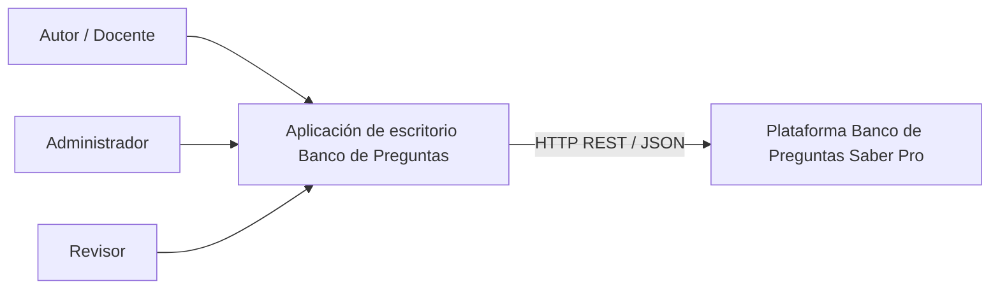
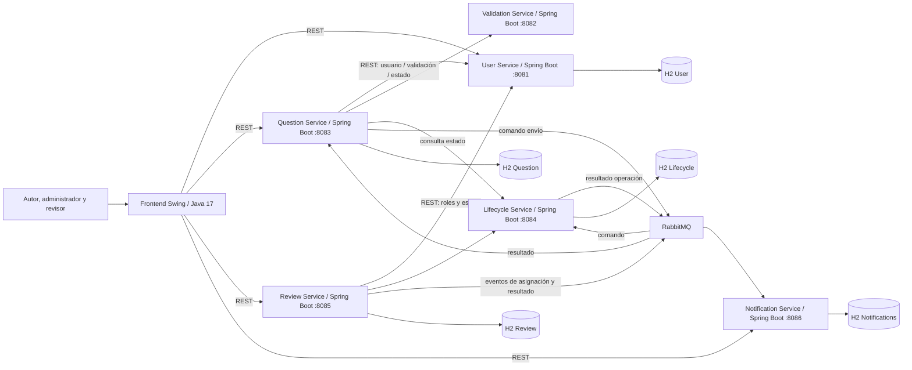
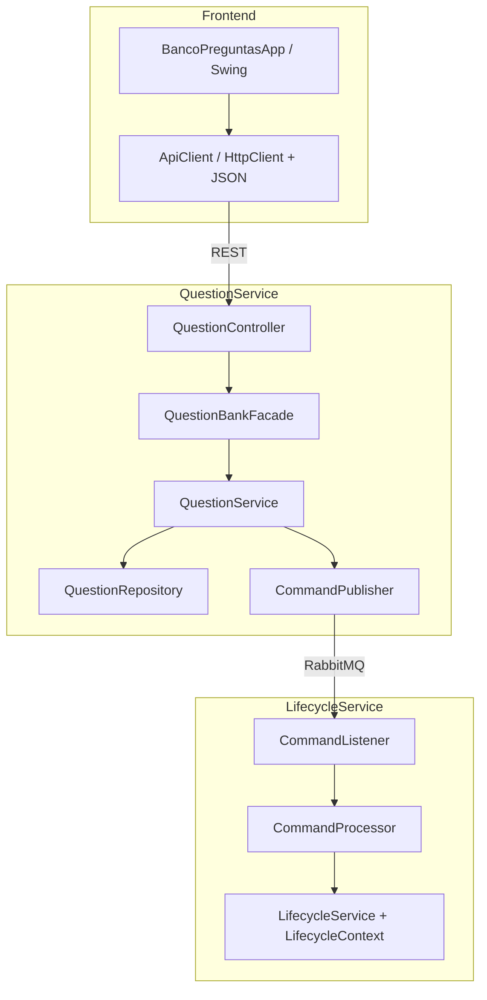
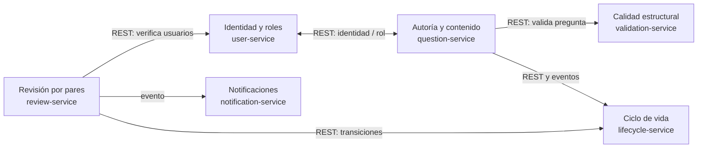
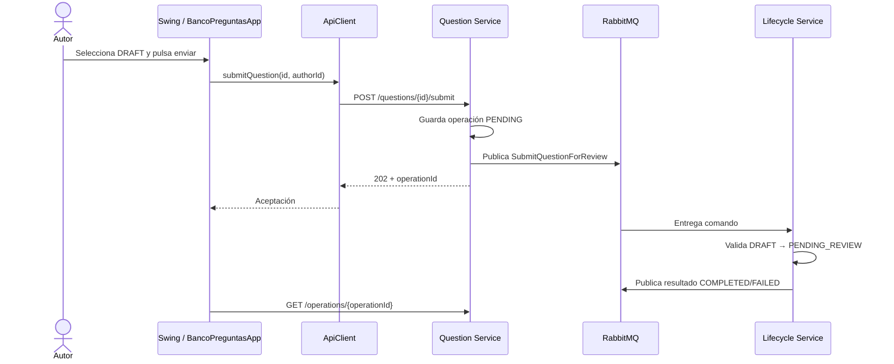

# Banco de Preguntas Saber Pro
## Informe de arquitectura — Segundo corte

**Asignatura:** Ingeniería de Software II  
**Universidad:** Universidad del Cauca  
**Integrantes:** Juan Hernández, Juan Meza y Joseph Trujillo *(confirmar nombres completos y orden antes de entregar)*  
**Fecha:** [día, mes y año]  
**Repositorio:** https://github.com/Mezitas/ProyectoIngSoftware2_BancoPreguntas  
**Video de sustentación:** [agregar URL de YouTube después de publicar]

---

## 1. Introducción

Este documento describe la arquitectura y el estado de implementación del Banco de Preguntas Saber Pro para el segundo corte de Ingeniería de Software II. La solución separa una interfaz de escritorio Java Swing de un backend compuesto por seis microservicios Spring Boot. Las APIs REST atienden solicitudes directas; RabbitMQ desacopla el envío de preguntas a revisión y la entrega de notificaciones. Cada servicio conserva la responsabilidad sobre sus datos.

El alcance funcional de esta iteración cubre la creación y validación de preguntas, el envío desde borrador a revisión, su consulta por el autor, la asignación de hasta tres revisores, la evaluación con observaciones y la notificación del resultado. El informe distingue las capacidades implementadas de los puntos que aún requieren evidencia o trabajo antes de afirmar cumplimiento completo.

## 2. Historias de usuario implementadas y criterios de aceptación

Las historias corresponden a los requisitos funcionales del segundo corte. Sus rutas de evidencia se indican desde la raíz del repositorio.

### HU1 — Crear preguntas Saber Pro

**Historia:** Como autor, quiero crear preguntas de selección múltiple con única respuesta para alimentar el banco Saber Pro.

**Criterios de aceptación**

- La pregunta contiene contexto, enunciado, cuatro opciones, una respuesta correcta, justificación, bibliografía, competencia, tema, subtema y nivel de dificultad.
- El backend valida campos requeridos, etiquetas A–D, opciones distintas, respuesta correcta y dificultad `BASIC`, `MEDIUM` o `HIGH`.
- Una creación válida persiste los metadatos y comienza en `DRAFT`; los datos inválidos se rechazan con errores explícitos.

**Evidencia de código**

- `frontend/src/main/java/com/bancopreguntas/desktop/BancoPreguntasApp.java`: `QuestionEditorDialog` reúne los campos para crear o editar la pregunta.
- `frontend/src/main/java/com/bancopreguntas/desktop/ApiClient.java`: serializa las solicitudes REST de creación y actualización.
- `backend/question-service/src/main/java/co/edu/unicauca/question/controller/QuestionController.java`: `POST /questions` expone el alta.
- `backend/question-service/src/main/java/co/edu/unicauca/question/service/QuestionService.java`: valida a través de Validation Service, persiste pregunta y estado inicial, y mapea bibliografía y dificultad.
- `backend/question-service/src/main/java/co/edu/unicauca/question/model/QuestionEntity.java`: define los datos persistidos de la pregunta.
- `backend/validation-service/src/main/java/co/edu/unicauca/validation/service/ValidationService.java`: aplica las reglas estructurales y devuelve todos los errores encontrados.

### HU2 — Enviar un borrador a revisión

**Historia:** Como autor, quiero enviar una pregunta en borrador a revisión para que el administrador pueda asignarle revisores.

**Criterios de aceptación**

- Solo se ofrece el envío para una pregunta en `DRAFT`.
- El sistema acepta la solicitud y devuelve un identificador de operación.
- Lifecycle procesa la transición a `PENDING_REVIEW`; una solicitud inválida puede finalizar como `FAILED`.
- Los estados se muestran con colores en la tabla de preguntas.

**Evidencia de código**

- `frontend/src/main/java/com/bancopreguntas/desktop/BancoPreguntasApp.java`: `submitSelectedQuestion()` envía la solicitud, consulta la operación y refresca la lista.
- `frontend/src/main/java/com/bancopreguntas/desktop/BancoPreguntasApp.java`: `StatusRenderer` asigna colores a `DRAFT`, `PENDING_REVIEW`, `IN_REVIEW`, `APPROVED` y `REJECTED`.
- `backend/question-service/src/main/java/co/edu/unicauca/question/controller/QuestionController.java`: `POST /questions/{id}/submit`.
- `backend/question-service/src/main/java/co/edu/unicauca/question/service/QuestionService.java`: crea la operación y publica el comando sin bloquear la respuesta HTTP.
- `backend/lifecycle-service/src/main/java/co/edu/unicauca/lifecycle/service/CommandProcessor.java`: consume el comando, ejecuta la transición y publica el resultado.

### HU3 — Consultar y editar preguntas

**Historia:** Como autor, quiero listar las preguntas que he creado para consultarlas y editar las que aún puedo corregir.

**Criterios de aceptación**

- El autor ve solo sus preguntas, identificadas por el usuario autenticado en la interfaz.
- El listado permite búsqueda, filtro por estado y paginación.
- Solo se editan preguntas `DRAFT` o `REJECTED`; al corregir una rechazada vuelve a `DRAFT`.

**Evidencia de código**

- `frontend/src/main/java/com/bancopreguntas/desktop/BancoPreguntasApp.java`: `refreshAuthorQuestions()` filtra por `authorId`; `QuestionTablePanel` busca, filtra por estado y pagina localmente los resultados recibidos.
- `backend/question-service/src/main/java/co/edu/unicauca/question/controller/QuestionController.java`: `GET /questions`, `GET /questions/{id}` y `PUT /questions/{id}`.
- `backend/question-service/src/main/java/co/edu/unicauca/question/service/QuestionService.java`: controla autor, permisos de edición y el retorno a `DRAFT`.

**Alcance del listado:** los filtros y la paginación están en el cliente Swing. El endpoint de backend `GET /questions` devuelve la colección; no se presentan como paginación o filtrado del servidor.

### HU4 — Asignar revisores

**Historia:** Como administrador, quiero asignar entre uno y tres revisores a una pregunta pendiente para iniciar su revisión por pares.

**Criterios de aceptación**

- Solo un usuario con rol `ADMIN` puede asignar revisores.
- El sistema verifica que cada revisor tenga el rol `REVISOR`, que no sea el autor y que no esté ya asignado.
- Una pregunta admite como máximo tres asignaciones activas.
- La primera asignación inicia `IN_REVIEW`; los asignados reciben una notificación en el sistema.
- El requisito académico solicita notificación por email al asignar. En esta implementación el servicio notifica de manera asíncrona, pero el envío de correo está simulado; ver limitaciones.

**Evidencia de código**

- `frontend/src/main/java/com/bancopreguntas/desktop/BancoPreguntasApp.java`: `assignReviewers()` recibe IDs de uno a tres usuarios y llama la API.
- `backend/review-service/src/main/java/co/edu/unicauca/review/controller/ReviewController.java`: `POST /reviews/assign`.
- `backend/review-service/src/main/java/co/edu/unicauca/review/service/ReviewService.java`: valida roles, estado, autor, duplicados y límite de revisores; registra asignación y publica el evento.
- `backend/review-service/src/main/java/co/edu/unicauca/review/messaging/ReviewerAssignedEvent.java`: contrato del evento de asignación.
- `backend/notification-service/src/main/java/co/edu/unicauca/notification/messaging/NotificationListener.java`: consume eventos de asignación.

### HU5 — Revisar y comunicar el resultado

**Historia:** Como revisor, quiero consultar mis preguntas asignadas y registrar una aprobación o rechazo con observaciones para que el autor conozca el resultado.

**Criterios de aceptación**

- El revisor ve sus asignaciones activas y puede evaluar cada pregunta una sola vez.
- El rechazo exige un motivo.
- Con varios revisores, el estado permanece `IN_REVIEW` hasta que respondan todos.
- El resultado agregado es `REJECTED` si algún voto rechaza; en caso contrario, `APPROVED`.
- El autor puede consultar las evaluaciones y sus observaciones; los implicados reciben notificación final.

**Evidencia de código**

- `frontend/src/main/java/com/bancopreguntas/desktop/BancoPreguntasApp.java`: `refreshReviewerQuestions()`, `evaluateSelectedQuestion()` y `showSelectedReviewResults()` muestran asignaciones, captura de la evaluación y consulta de observaciones.
- `backend/review-service/src/main/java/co/edu/unicauca/review/controller/ReviewController.java`: `GET /reviews/reviewer/{reviewerId}`, `POST /reviews/result` y `GET /reviews/question/{questionId}/results`.
- `backend/review-service/src/main/java/co/edu/unicauca/review/service/ReviewService.java`: controla voto único, motivo obligatorio y consenso antes de cambiar el estado final.
- `backend/notification-service/src/main/java/co/edu/unicauca/notification/messaging/NotificationListener.java`: procesa las notificaciones de resultado.
- `backend/notification-service/src/main/java/co/edu/unicauca/notification/service/EmailService.java`: simula el envío diferido y registra el mensaje en log; no envía correo real en esta versión.

## 3. Planificación del Sprint 2

**Evidencia requerida:** insertar aquí una captura legible del tablero de Jira o Trello del Sprint 2, donde se vean el nombre del tablero, las tareas, su estado y, si está disponible, los responsables.

> **[INSERTAR CAPTURA DEL TABLERO REAL DEL SPRINT 2]**

No se incluye una captura ficticia. Antes de entregar, añadir la evidencia tomada del tablero utilizado por el equipo.

## 4. Escenario de calidad: escalabilidad

### Escenario propuesto

| Elemento | Descripción |
|---|---|
| Contexto | El sistema opera normalmente y sus seis microservicios y RabbitMQ están disponibles. |
| Estímulo | Un pico de 100 solicitudes concurrentes crea preguntas y solicita su envío a revisión. |
| Respuesta | Question Service valida y persiste preguntas; Validation Service escala independientemente según carga. El envío retorna aceptación y publica un comando; consumidores Lifecycle procesan las operaciones de forma asíncrona. |
| Medición | Latencia p95 menor a 2 segundos para aceptar un envío, cero comandos perdidos y finalización de al menos 99 de 100 operaciones en 30 segundos. Registrar errores HTTP, profundidad de cola, latencia y operaciones `COMPLETED`/`FAILED`. |
| Resultado esperado | Aumentar instancias del servicio con mayor carga sin duplicar la aplicación completa; los comandos y eventos son procesados de manera idempotente. El número de réplicas y el umbral son objetivos iniciales, sujetos a validación experimental. |

### Evidencia arquitectónica

- `backend/question-service/src/main/java/co/edu/unicauca/question/messaging/CommandPublisher.java`: publica el comando de envío.
- `backend/lifecycle-service/src/main/java/co/edu/unicauca/lifecycle/service/CommandProcessor.java`: procesa comandos, evita repetir operaciones por `operationId` y publica resultados.
- `backend/notification-service/src/main/java/co/edu/unicauca/notification/messaging/NotificationListener.java`: consume eventos sin bloquear la asignación o decisión de revisión.
- `backend/docker-compose.yml`: infraestructura local de RabbitMQ.

**Estado de medición:** no se encontró evidencia de una prueba de carga ejecutada. Los valores anteriores son metas propuestas para el escenario y no deben reportarse como resultados observados hasta ejecutar y adjuntar la prueba.

## 5. Arquitectura y diseño de software — modelo C4

### C1 — Contexto



### C2 — Contenedores



Las bases H2 mostradas son independientes por servicio y en memoria en la configuración de ejemplo: los datos se pierden al reiniciar. El frontend no inicia los servicios ni accede directamente a sus bases de datos.

### C3 — Componentes representativos



### Contextos delimitados representados



Los contextos de simulacros, seguimiento académico y trazabilidad que aparecen en la Figura 1 se consideran fuera del alcance implementado de esta iteración.

### UML de secuencia — envío a revisión



### Separación y comunicación

La aplicación de escritorio y el backend son procesos independientes. `frontend/src/main/java/com/bancopreguntas/desktop/ApiClient.java` concentra las solicitudes HTTP y configura URLs por variables de entorno. `backend/question-service/src/main/java/co/edu/unicauca/question/controller/QuestionController.java` y `backend/review-service/src/main/java/co/edu/unicauca/review/controller/ReviewController.java` exponen recursos REST. RabbitMQ se reserva para interacciones asíncronas. La búsqueda y paginación del listado se hacen en la aplicación Swing sobre los datos entregados por `GET /questions`.

## 6. Patrones de diseño

El README del backend enumera los patrones presentes en la solución. El siguiente listado relaciona una clase y una función verificable en el código:

| Patrón | Categoría | Código | Aplicación |
|---|---|---|---|
| Builder | Creacional | `backend/question-service/src/main/java/co/edu/unicauca/question/builder/QuestionBuilder.java`, `QuestionDirector.java` | Construye un reactivo por partes y comprueba cuatro opciones y una respuesta correcta. `QuestionDirector` ofrece construcciones predefinidas. |
| Adapter | Estructural | `backend/question-service/src/main/java/co/edu/unicauca/question/adapter/ExternalQuestionAdapter.java` | Convierte respuestas externas JSON o cadenas crudas al contrato `QuestionProvider` y al modelo interno. |
| Facade | Estructural | `backend/question-service/src/main/java/co/edu/unicauca/question/facade/QuestionBankFacade.java` | Unifica operaciones del caso de uso y oculta al controlador la colaboración de servicios, repositorio, importador y decoradores. |
| Decorator | Estructural | `backend/question-service/src/main/java/co/edu/unicauca/question/decorator/FeedbackQuestion.java`, `HighDifficultyQuestion.java`; composición en `QuestionBankFacade.java` | Añade retroalimentación o dificultad a una presentación sin modificar el componente base. |
| State | Comportamiento | `backend/lifecycle-service/src/main/java/co/edu/unicauca/lifecycle/state/LifecycleContext.java`, `DraftState.java`, `PendingReviewState.java`, `InReviewState.java`, `ApprovedState.java`, `RejectedState.java` | Cada estado acepta o rechaza transiciones propias; el contexto delega la operación al estado actual. |
| Template Method | Comportamiento | `backend/validation-service/src/main/java/co/edu/unicauca/validation/templatemethod/QuestionEvaluator.java`, `MultipleChoiceEvaluator.java`, `TrueFalseEvaluator.java`, `CaseStudyEvaluator.java` | `evaluate()` fija la secuencia común; las subclases implementan formato y cálculo particulares. |

### Verificación de la cuota GoF

El requisito solicita **al menos dos creacionales, dos estructurales y dos de comportamiento**. Los ejemplos verificables de la tabla acreditan Builder como creacional, Adapter/Facade/Decorator como estructurales y State/Template Method como de comportamiento. `QuestionEvaluatorFactory` contiene métodos estáticos que crean evaluadores; eso puede describirse como una fábrica simple, pero no se presenta aquí como Factory Method o Abstract Factory GoF. Por lo tanto, **el segundo patrón creacional no queda acreditado de manera inequívoca en el código actual**. Antes de declarar cumplimiento total, implementar un segundo patrón creacional GoF apropiado y agregar una prueba que evidencie su uso, o confirmar con el docente que la fábrica simple es aceptable.

## 7. Pruebas unitarias automatizadas

Ejecutar desde `backend`:

```powershell
mvn test
```

Pruebas representativas:

- `backend/question-service/src/test/java/co/edu/unicauca/question/QuestionBuilderTest.java`: construcción y reglas del Builder.
- `backend/question-service/src/test/java/co/edu/unicauca/question/QuestionServiceTest.java`: orquestación de creación, estado y operaciones.
- `backend/question-service/src/test/java/co/edu/unicauca/question/QuestionDecoratorTest.java`: composición de presentación decorada.
- `backend/review-service/src/test/java/co/edu/unicauca/review/ReviewServiceTest.java`: asignación, límites y resultado agregado de revisores.
- `backend/validation-service/src/test/java/co/edu/unicauca/validation/ValidationServiceTest.java`: reglas estructurales y metadatos.
- `backend/lifecycle-service/src/test/java/co/edu/unicauca/lifecycle/LifecycleContextTest.java`: transiciones permitidas y no permitidas.
- `backend/user-service/src/test/java/co/edu/unicauca/user/PasswordHasherTest.java`: hash y verificación de contraseña.

La existencia de pruebas no implica cobertura de cada clase de dominio y servicio. En particular, no se hallaron pruebas unitarias en `notification-service`; el cumplimiento del criterio de cobertura completa debe comprobarse con cobertura y casos adicionales, no inferirse solo por una ejecución exitosa de Maven. Adjuntar la salida real del comando o un reporte JaCoCo si está disponible.

## 8. Limitaciones y asuntos pendientes

1. **Swagger/OpenAPI:** no se encontró `springdoc-openapi` ni configuración Swagger en los POM del backend. El protocolo exige mostrar la API generada por Swagger durante un minuto; agregar la dependencia, configurar y comprobar Swagger UI antes de grabar. Postman no reemplaza esa evidencia.
2. **Segundo patrón creacional:** el código acredita Builder; la fábrica estática de evaluadores no es inequívocamente Factory Method/Abstract Factory GoF. Completar o validar este punto.
3. **Email:** `backend/notification-service/src/main/java/co/edu/unicauca/notification/service/EmailService.java` simula el envío con una demora y un log. Las notificaciones se procesan y persisten en el sistema, pero no se envía correo real.
4. **Escalabilidad:** el escenario define métricas objetivo, pero no se adjunta una prueba de carga ejecutada. Presentar resultados solo después de medirlos.
5. **Tablero Sprint 2 y URLs:** falta insertar la captura auténtica del tablero y la URL del video publicado.
6. **Persistencia de demostración:** H2 está configurada en memoria y se pierde al reiniciar. No utilizar cuentas o preguntas de demostración como datos persistentes.
7. **Cobertura de pruebas:** revisar el alcance de pruebas contra todas las clases de dominio y servicios solicitadas por la rúbrica.

## 9. URL del video de YouTube

**[Agregar enlace público o no listado al video final de 15 minutos.]**

## 10. URL del repositorio Git

https://github.com/Mezitas/ProyectoIngSoftware2_BancoPreguntas
