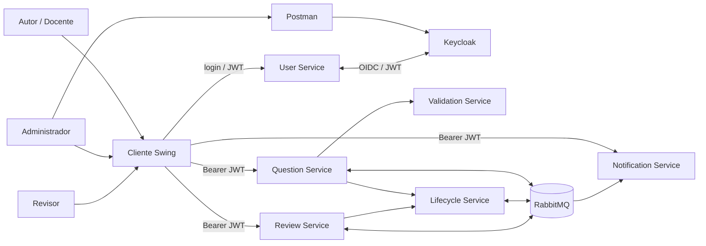
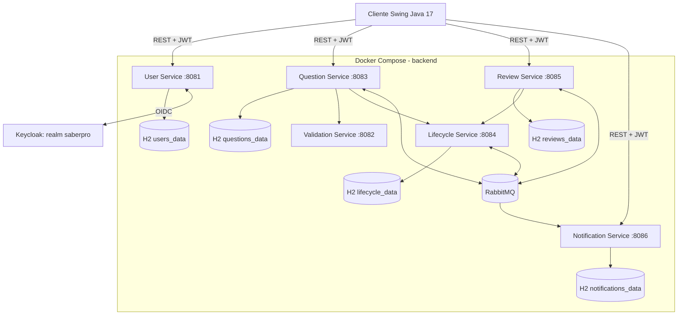
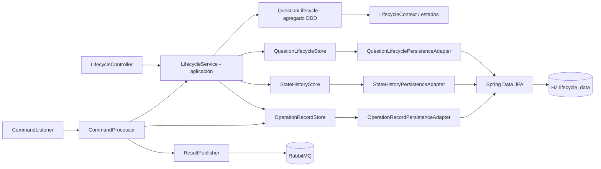

# Backend Saber Pro

Backend Java 17 / Spring Boot 3.3 compuesto por seis microservicios. Cada servicio es dueño de su persistencia y expone una API REST independiente; Question, Review y Lifecycle también usan RabbitMQ para comandos y eventos asíncronos. Keycloak es el proveedor de identidad y emite los JWT consumidos por las seis APIs.

## Requisitos

- Docker Desktop actualizado con Docker Compose v2.
- JDK 17+ y Maven 3.8+ solo para ejecutar pruebas o levantar un servicio directamente desde código.
- Postman para explorar APIs y administrar usuarios/roles en Keycloak.

No se requiere instalar Java ni Maven para iniciar el stack en contenedores: la imagen de cada microservicio compila el código con Maven.

## Inicio rápido en Windows

Desde la raíz del repositorio:

```powershell
Set-Location .\backend
docker compose up --build -d
docker compose ps
```

La primera ejecución descarga las imágenes y compila los servicios. Para observar los registros:

```powershell
docker compose logs -f
# o un servicio específico
docker compose logs -f user-service
```

También se puede usar `.\start-all.bat` desde `backend`. Para detener contenedores conservando los datos:

```powershell
docker compose down
```

Los datos de H2, RabbitMQ y Keycloak viven en volúmenes con nombre. `docker compose down -v` elimina esos volúmenes y **borra las bases y usuarios de Keycloak**. Usa ese comando solo si quieres reiniciar todos los datos. Al cambiar las credenciales demo en un archivo `.env`, recuerda que RabbitMQ y Keycloak solo aplican los valores iniciales cuando se crea por primera vez su volumen.

## Servicios y documentación HTTP

| Servicio | Puerto | Responsabilidad | Swagger UI |
|---|---:|---|---|
| User Service | 8081 | Inicio de sesión delegado a Keycloak y perfiles/roles locales | `http://localhost:8081/swagger-ui/index.html` |
| Validation Service | 8082 | Validación estructural y evaluación | `http://localhost:8082/swagger-ui/index.html` |
| Question Service | 8083 | Creación, consulta, edición e importación de preguntas | `http://localhost:8083/swagger-ui/index.html` |
| Lifecycle Service | 8084 | Autoridad de estados, transiciones e historial | `http://localhost:8084/swagger-ui/index.html` |
| Review Service | 8085 | Asignación de revisores y resultados | `http://localhost:8085/swagger-ui/index.html` |
| Notification Service | 8086 | Consulta y registro de notificaciones | `http://localhost:8086/swagger-ui/index.html` |

Cada API publica OpenAPI en `http://localhost:<puerto>/v3/api-docs`. Swagger UI y OpenAPI son públicos para consulta; las operaciones de negocio requieren un JWT. Pulsa **Authorize** en Swagger UI y proporciona `Bearer <access_token>`.

Dependencias: Keycloak `http://localhost:8180` (realm `saberpro`) y RabbitMQ `http://localhost:15672`. Para el perfil local, las credenciales demo de la consola son `admin / AdminKeycloak123!` y `saberpro / SaberProRabbit123!`, respectivamente. Cambia las contraseñas y secretos antes de cualquier despliegue no local.

## Inicio de sesión y JWT

El realm de demostración se importa desde `keycloak/realm-saberpro.json`. Incluye los roles `DOCENTE`, `AUTOR`, `ADMIN`, `REVISOR` y `ESTUDIANTE`, junto con usuarios de prueba:

| Usuario | Contraseña | Roles |
|---|---|---|
| `docente1` | `Docente123*` | `DOCENTE`, `AUTOR` |
| `admin1` | `Admin123*` | `ADMIN` |
| `revisor1` | `Revisor123*` | `REVISOR` |
| `revisor2` | `Revisor123*` | `REVISOR` |
| `estudiante1` | `Estudiante123*` | `ESTUDIANTE` |

El cliente Swing inicia sesión en `POST http://localhost:8081/auth/login` con:

```json
{
  "username": "docente1",
  "password": "Docente123*"
}
```

La respuesta contiene el perfil y `accessToken`. El User Service delega la verificación de credenciales a Keycloak, valida la firma y el emisor del token, y sincroniza los datos del perfil local y sus roles. Los usuarios demo tienen un perfil precargado para conservar IDs estables; cualquier nuevo usuario de Keycloak se provisiona en User Service la primera vez que inicia sesión. Las seis APIs validan los JWT de forma independiente y extraen autoridades de `realm_access.roles`.

Las llamadas REST del cliente deben llevar `Authorization: Bearer <access_token>`. Se requiere rol `DOCENTE` o `AUTOR` para crear, editar o enviar preguntas; `ADMIN` para asignar revisores; y `REVISOR` para evaluar preguntas y consultar sus asignaciones. Los endpoints de negocio restantes requieren un usuario autenticado. La comunicación REST de Question y Review reenvía el token entrante a los servicios que invoca. RabbitMQ queda en la red privada de Compose y sus consumidores procesan eventos internos.

### Administrar usuarios y roles desde Postman

No se necesita una pantalla de administración en el frontend. Para crear usuarios y asignar roles se usa la API Admin REST de Keycloak:

1. En Postman solicita un token de administrador en `POST http://localhost:8180/realms/master/protocol/openid-connect/token`, con `Content-Type: application/x-www-form-urlencoded` y los campos `grant_type=password`, `client_id=admin-cli`, `username=admin`, `password=AdminKeycloak123!`.
2. Usa el token obtenido como `Authorization: Bearer <admin_token>` en las siguientes solicitudes.
3. Consulta roles con `GET http://localhost:8180/admin/realms/saberpro/roles`. Para obtener uno específico: `GET /admin/realms/saberpro/roles/REVISOR`.
4. Crea una cuenta con `POST http://localhost:8180/admin/realms/saberpro/users`, `Content-Type: application/json` y, por ejemplo:

   ```json
   {
     "username": "docente2",
     "enabled": true,
     "email": "docente2@unicauca.edu.co",
     "firstName": "Docente",
     "lastName": "Dos",
     "credentials": [{ "type": "password", "value": "Cambiar123*", "temporary": false }]
   }
   ```

5. Localiza el ID creado con `GET /admin/realms/saberpro/users?username=docente2`. Asigna roles mediante `POST http://localhost:8180/admin/realms/saberpro/users/{id}/role-mappings/realm` y un cuerpo JSON en arreglo con el objeto del rol obtenido en el paso 3.
6. Al iniciar sesión por primera vez en `POST http://localhost:8081/auth/login`, el perfil local se crea automáticamente a partir de los claims validados del token. Configura correo y roles en Keycloak antes del primer inicio de sesión.

El usuario de administración se administra en el realm `master`; los roles del producto pertenecen al realm `saberpro`. Los tokens de administrador no deben usarse para invocar APIs de negocio.

### Usar Postman para invocar APIs

Importa `postman/SaberPro_Microservices.postman_collection.json` y `postman/SaberPro_Local.postman_environment.json`. Inicia sesión en User Service para obtener un token y define el encabezado Bearer en las solicitudes de negocio de la colección. Se puede usar la colección para validar los flujos funcionales; debido a la seguridad agregada, las solicitudes protegidas ya no aceptan llamadas anónimas.

## Flujos de negocio y rutas principales

1. `POST /auth/login` valida las credenciales en Keycloak y devuelve el JWT junto al usuario.
2. `POST /questions` valida el rol del autor, consulta User Service y Validation Service, persiste el contenido y registra el estado inicial `DRAFT`.
3. `POST /questions/{id}/submit` publica un comando durable en RabbitMQ y devuelve `202 Accepted` con un `operationId`. Consulta `GET /operations/{operationId}` para ver `COMPLETED` o `FAILED`.
4. Lifecycle Service valida `DRAFT → PENDING_REVIEW`, registra historial y publica el resultado del comando.
5. `POST /reviews/assign` (ADMIN) valida pregunta y revisor, solicita `IN_REVIEW` a Lifecycle, registra asignación y publica el evento de notificación.
6. `POST /reviews/result` (REVISOR) registra aprobación/rechazo con observaciones. Con varios revisores, la pregunta se resuelve cuando todos evalúan: el resultado global es `REJECTED` si alguno la rechaza; de lo contrario, `APPROVED`.
7. El autor consulta historial y observaciones para corregir y volver a enviar la pregunta. Notification Service procesa eventos de forma asíncrona.

`POST /reviews/assign` permite de uno a tres revisores distintos, rechaza al autor como revisor y evita asignaciones duplicadas o una cuarta asignación activa. `GET /reviews/reviewer/{reviewerId}` lista asignaciones; `GET /reviews/question/{questionId}/results` expone resultados y comentarios. Los listados, filtros, estados coloreados y paginación del escritorio completan la interfaz de la entrega.

## Historias de usuario y criterios de aceptación

| Historia | Criterios de aceptación implementados |
|---|---|
| Como autor quiero crear preguntas de selección múltiple con única respuesta para alimentar Saber Pro. | Captura contexto, enunciado, cuatro opciones, clave, justificación, bibliografía, competencia, tema, subtema y dificultad. Validation Service comprueba la estructura antes de guardar; devuelve error si no cumple. |
| Como autor quiero enviar un borrador a revisión. | Una pregunta en `DRAFT` puede enviarse; el cambio a `PENDING_REVIEW` es validado por Lifecycle y se muestra con color en el cliente. |
| Como autor quiero consultar mis preguntas para verlas o editarlas. | El cliente ofrece búsqueda, filtros y paginación sobre el listado, y muestra el estado que informa Lifecycle. La corrección respeta los estados definidos por el ciclo de vida. |
| Como administrador quiero asignar revisores. | Se pueden asignar de uno a tres revisores distintos a una pregunta pendiente; no se permite el autor, duplicados ni una cuarta asignación. La asignación produce un evento para Notification Service. |
| Como revisor quiero consultar y evaluar preguntas asignadas. | El revisor consulta sus asignaciones y registra `APPROVED` o `REJECTED` con observaciones; el rechazo exige motivo. Los resultados se notifican a los implicados. |
| Como autor quiero consultar revisiones y observaciones para mejorar una pregunta. | El historial del ciclo de vida y los resultados de revisión se consultan por pregunta. El autor corrige y reenvía; las notificaciones se procesan por eventos. |

## Arquitectura: microservicios y DDD

Se mantiene **Database per Service**: cada microservicio de dominio persiste únicamente sus propios datos. En Compose se usa H2 en modo archivo, un volumen nombrado por servicio; al ejecutar servicios desde Maven, la configuración por defecto usa una base en memoria para facilitar las pruebas. Question Service no persiste el estado del ciclo de vida: consulta a Lifecycle Service, autoridad única del estado.

El `lifecycle-service` aplica DDD y separación por capas:

| Capa | Código | Responsabilidad |
|---|---|---|
| Dominio | `domain/QuestionLifecycle`, `domain/StateHistoryRecord`, `state/` | Agregado, estados y reglas de transición; sin dependencias de JPA ni HTTP |
| Aplicación | `service/LifecycleService` | Casos de uso transaccionales: registrar, consultar, transicionar y auditar |
| Puertos de salida | `port/QuestionLifecycleStore`, `StateHistoryStore`, `OperationRecordStore` | Contratos que necesita el caso de uso para leer y persistir |
| Adaptadores | `adapter/persistence/` | Traducción entre agregado/modelos de consulta y entidades JPA |
| Entrada | `controller/` y `messaging/` | Adaptadores REST y consumidores de comandos RabbitMQ |

El agregado delega las transiciones válidas al patrón State. La capa de aplicación usa puertos, y los adaptadores implementan esos contratos con repositorios Spring Data. `LifecycleContextTest`, `QuestionLifecycleTest`, `LifecycleServiceTest`, `CommandProcessorTest` y `QuestionLifecyclePersistenceAdapterTest` ejercitan reglas, casos de uso y adaptación sin levantar Spring.

### Vistas C4

**Nivel 1 — contexto.** Usuarios interactúan desde el cliente Swing; Keycloak administra identidades/roles y las APIs implementan los flujos de negocio. Postman sirve como cliente alternativo de API y de administración del realm.



**Nivel 2 — contenedores.** Compose ejecuta seis APIs Spring Boot, Keycloak, RabbitMQ y una base H2 independiente por servicio con persistencia montada en volúmenes. El cliente de escritorio se inicia por separado en el equipo del usuario.



**Nivel 3 — componentes del Lifecycle Service.** REST y los consumidores RabbitMQ entran al caso de uso; el agregado valida cambios y los puertos aíslan las salidas de persistencia.



### Escenarios de calidad: modificabilidad y escalabilidad

Los siguientes escenarios definen metas verificables de diseño; **no representan mediciones de carga ejecutadas**.

| Atributo | Contexto y estímulo | Respuesta esperada | Medición / umbral de aceptación |
|---|---|---|---|
| Modificabilidad | El negocio añade un nuevo estado de pregunta o una transición. | El cambio se limita al dominio del Lifecycle Service (estado, agregado y pruebas); los demás microservicios conservan sus contratos REST/RabbitMQ. | Pruebas unitarias del dominio pasan; cero cambios de persistencia/controladores o de los otros cinco microservicios para una regla que no cambie el contrato. |
| Escalabilidad | Aumenta el volumen de solicitudes de creación y revisión manteniendo las reglas del flujo. | Escalar Question, Validation o Review como instancias independientes detrás de balanceador; RabbitMQ absorbe comandos/eventos. Para escalar persistencia, sustituir H2 por un motor compartido soportado, conservando el aislamiento lógico por servicio. | Prueba de carga propuesta: duplicar solicitudes por minuto y comparar percentil p95, tasa de errores y profundidad de cola; objetivo p95 < 2 s y errores < 1% en operaciones síncronas. La meta requiere ejecutar y registrar la prueba en el entorno objetivo. |

### Seguridad

Cada microservicio es un Resource Server OAuth2. Los filtros JWT verifican firma, emisor configurado y expiración usando las claves públicas de Keycloak; el convertidor toma roles del realm como autoridades `ROLE_*`. Las rutas públicas se limitan a login y documentación OpenAPI. Las restricciones principales se aplican en los filtros del Question y Review Service. El acceso a Keycloak desde el cliente usa el flujo de credenciales de usuario, habilitado en el cliente público de demostración; en producción debe usarse Authorization Code con PKCE y HTTPS.

### Persistencia y mensajería

Los volúmenes Compose son `users_data`, `questions_data`, `reviews_data`, `lifecycle_data`, `notifications_data`, `keycloak_data` y `rabbitmq_data`. Las bases H2 persisten dentro de `/data` en el contenedor. Los mensajes usan colas durables y los consumidores mantienen sus responsabilidades independientes. RabbitMQ queda accesible localmente para desarrollo en `localhost:5672`; no se publica una base de datos de servicio en un puerto del host.

## Patrones de diseño existentes

| Patrón | Servicio | Uso |
|---|---|---|
| State | Lifecycle | Controla transiciones oficiales y evita saltos entre estados |
| Builder / Director | Question | Construye preguntas con cuatro opciones |
| Factory Method / Template Method | Validation | Selecciona y ejecuta el evaluador según tipo de pregunta |
| Adapter | Question | Normaliza datos recibidos de proveedores externos |
| Facade | Question | Unifica operaciones del banco para el controlador |
| Decorator | Question y Validation | Enriquece la presentación con dificultad y retroalimentación |
| Repository / Ports and Adapters | Lifecycle | Aísla persistencia del agregado de dominio |

## Ejecutar pruebas y compilar desde código

Desde `backend`, con JDK 17+ y Maven 3.8+:

```powershell
mvn test
mvn clean package
```

Para desarrollar un microservicio localmente, inicia únicamente las dependencias con `docker compose up -d keycloak rabbitmq`; luego ejecuta el servicio desde su módulo, por ejemplo:

```powershell
Set-Location .\question-service
mvn spring-boot:run
```

Los valores de configuración se pueden sobrescribir con variables de entorno: `SERVER_PORT`, `DB_URL`, `RABBIT_HOST`, `RABBIT_PORT`, `RABBIT_USER`, `RABBIT_PASS`, `KEYCLOAK_ISSUER_URI`, `KEYCLOAK_JWK_SET_URI`, `KEYCLOAK_TOKEN_URL`, `KEYCLOAK_CLIENT_ID`, `USER_SERVICE_URL`, `VALIDATION_SERVICE_URL`, `LIFECYCLE_SERVICE_URL` y `EMAIL_DELAY_MS`. En Compose, los nombres de host de servicios (`keycloak`, `rabbitmq`, etc.) solo son resolubles dentro de la red de contenedores; las ejecuciones locales usan `localhost`.

## Evidencia del documento final de arquitectura

Este README documenta requisitos, tecnología, seguridad, DDD, vistas C4, patrones y escenarios de calidad. La entrega académica también solicita un PDF con portada, historias de las tres iteraciones, capturas de planificación de Sprint 1–3 y documento de arquitectura final. Este repositorio contiene algunos materiales de cortes anteriores, pero no la evidencia de planificación del Sprint 3 ni una portada consolidada; el README no sustituye esas evidencias y no se inventan capturas. Antes de entregar, consolida el PDF con el material real del equipo y adjunta las capturas faltantes.
